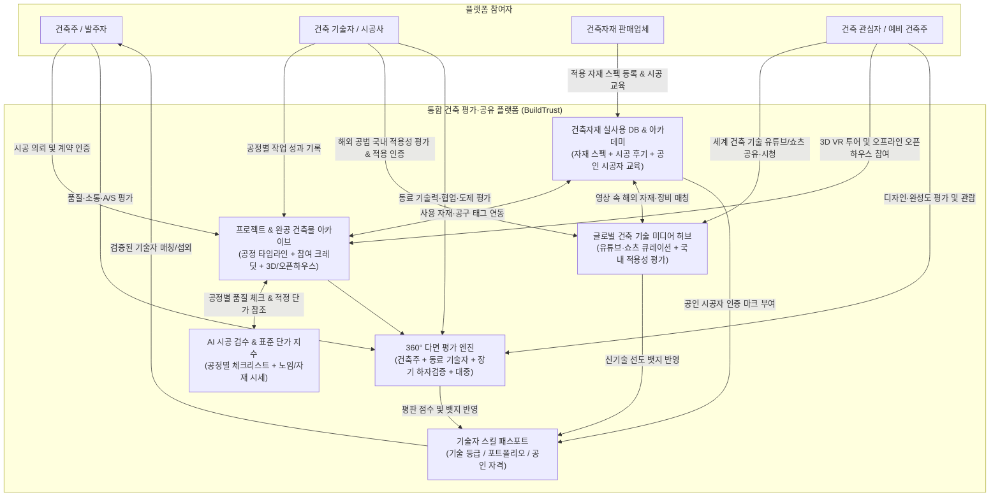

# 🏗️ 건축 통합 평가·공유 생태계 플랫폼 기획서
**가칭: 빌드트러스트 (BuildTrust) — "투명한 기술 검증과 완공 가치 공유를 위한 건축 커뮤니티 & 매칭 플랫폼"**

---

## 1. 기획 배경 및 목적 (Background & Objective)

### 1.1 시장의 문제점 (Pain Points)
1. **정보 비대칭성 심화**: 건축주와 일반인은 시공 기술자(목수, 철근, 타일, 설비, 전기, 도장 등) 및 시공사의 실제 작업 수준과 하자 이력을 객관적으로 확인하기 어렵습니다.
2. **기술자의 역량 증명 한계**: 뛰어난 숙련도를 가진 시공 기술자나 전문 팀이 자신의 실제 시공 과정과 작업 성과를 체계적인 포트폴리오로 축적·검증받을 공식 채널이 부족합니다.
3. **단절된 생태계**: 건축주, 현장 기술자, 설계/시공사, 자재 유통/제조사, 예비 건축주(관심자)가 각자의 채널에 파편화되어 있어 공정별 자재 적합성이나 실제 시공 후기에 대한 교차 검증이 어렵습니다.

### 1.2 플랫폼 비전 및 목표
- **신뢰 기반의 기술 검증**: 시공 과정부터 완공, 사후 관리(하자 보수)까지 전 과정을 기록하고 다면 평가(건축주·동료 기술자·감리·대중)를 통해 객관적인 **기술자 등급 및 평판 시스템**을 구축합니다.
- **투명한 건축 아카이브**: 완공된 건축물에 투입된 실제 기술자 명단(크레딧), 사용된 건축 자재 스펙, 공정별 데이터를 투명하게 공개하고 공유합니다.
- **글로벌 건축 기술 지식 허브**: 세계 각국의 혁신적인 건축 공법, 첨단 장비, 장인들의 시공 노하우가 담긴 **유튜브(YouTube) 영상 및 쇼츠(Shorts)**를 큐레이션·공유하고 국내 현장 적용 가능성을 함께 토론·검증합니다.
- **선순환 건축 비즈니스 생태계**: 검증된 기술자와 건축주를 연결하고, 자재 업체는 실제 시공 사례 및 글로벌 기술 트렌드를 통해 자재를 홍보·판매하는 올인원(All-in-One) 생태계를 조성합니다.

---

## 2. 주요 타겟 사용자 및 페르소나 (Target Users)

| 구분 | 세부 대상 | 핵심 니즈 (Needs) | 플랫폼 내 주요 활동 |
| :--- | :--- | :--- | :--- |
| **건축 기술자 / 전문가** | 공정별 기술자(목공, 타일, 미장, 설비 등), 건축사, 시공사, 감리자 | • 본인의 기술력 증명 및 정당한 단가 인정 • 안정적인 일감 확보 및 팀원 구인 • 해외 선진 공법·신자재·장비 정보 습득 | • 작업 일지 및 공정별 포트폴리오 등록 • 완공 건축물 참여 크레딧(Credit) 인증 • 글로벌 시공 영상/쇼츠 공유 및 전문가 코멘트 작성 |
| **건축주 (현재/과거)** | 신축·리모델링·인테리어 발주자, 건물 소유주 | • 믿을 수 있는 기술자/시공사 탐색 • 공정별 품질 확인 및 하자 예방 • 적정 견적 및 자재 가격 파악 | • 시공 의뢰 및 견적 비교 • 공정 단계별·완공 후 기술자 평가 작성 • 해외 건축 사례 영상을 참고한 시공 요청 |
| **건축 관심자 (예비 건축주)** | 예비 건축주, 건축 학도, 인테리어/공간 애호가 | • 실패 없는 건축 노하우 및 레퍼런스 탐색 • 실제 건축 비용 및 자재 장단점 파악 • 흥미로운 세계 건축 기술 콘텐츠 소비 | • 완공 건축물 투어/아카이브 열람 및 평가 • 세계 각국의 건축 유튜브·쇼츠 시청 및 공유 • 기술자/건축주 Q&A 및 커뮤니티 소통 |
| **건축자재 판매/제조업체** | 건자재 제조사, 유통 대리점, 특수 자재 수입사 | • 현장 기술자 및 건축주 대상 타겟 마케팅 • 자사 자재가 적용된 실제 시공사례 확보 • 해외 신자재/특수 공구 국내 도입 및 홍보 | • 디지털 자재 카탈로그 및 단가/스펙 등록 • 완공 건축물 및 글로벌 기술 영상에 자사 취급 자재/공구 태그 연동 |

---

## 3. 핵심 기능 정의 (Core Features)

### 3.1 프로젝트 & 완공 건축물 크레딧 아카이브 (Building Credits)
- **영화 엔딩 크레딧 방식의 참여자 인증**: 하나의 완공 건축물 페이지에 설계자, 시공사뿐만 아니라 **기초, 골조, 외장, 창호, 목공, 타일, 전기, 설비 등 각 공정에 참여한 실제 기술자**와 **투입된 핵심 건축 자재**를 태그하여 연결합니다.
- **공정별 타임라인 뷰어**: 착공부터 골조, 단열/방수(은폐 공정), 마감, 준공까지 단계별 현장 사진·영상을 시간순으로 기록하여 눈에 보이지 않는 내부 시공 품질까지 증명합니다.

### 3.2 다면 평가 및 기술 등급 시스템 (Multi-Angle Evaluation)
단순 별점 테러나 허위 리뷰를 방지하기 위해 **평가 주체별 가중치**와 **시기별 평가**를 분리합니다.

1. **건축주 평가 (계약 인증 필수)**
   - 평가 항목: 시공 품질(마감도), 일정 준수율, 소통 및 피드백, 현장 정리정돈, 추가 비용 투명성, A/S(하자 보수) 대응력
2. **동료 기술자 & 감리자 교차 평가 (현장 참여 인증)**
   - 평가 항목: 도면 이해도, 선·후행 공정 배려(협업도), 전문 장비 활용 및 안전 수칙 준수, 기술 숙련도
3. **장기 거주/유지보수 평가 (Time-Delayed Review)**
   - 준공 직후뿐만 아니라 **준공 6개월 / 1년 / 3년 후** 계절 변화(장마철 누수, 겨울철 결로/단열 등)를 겪은 뒤의 실제 품질 평가를 추가 반영하여 신뢰도를 극대화합니다.
4. **대중(건축 관심자) 평가 및 큐레이션**
   - 완공 건축물의 디자인, 공간 활용도, 자재 조화도에 대한 공감·투표 및 리뷰 공유

### 3.3 기술자 디지털 프로필 & 스킬 패스포트 (Skill Passport)
- **검증된 포트폴리오**: 본인이 직접 참여한 현장과 공정 사진, 보유 자격증, 경력 연차, 주력 공법을 한눈에 볼 수 있는 프로필 제공
- **기술 뱃지 & 티어(Tier) 시스템**: 누적 시공 건수, 무하자 기록, 동료 추천 수, 건축주 평점을 종합한 데이터 기반 기술 등급 부여

### 3.4 건축자재 쇼룸 & 실사용 연동 DB (Material Hub)
- **자재-시공 사례 매칭**: 특정 벽돌, 창호, 타일, 단열재를 검색하면 해당 자재가 실제로 시공된 완공 건축물 사진과 **그 자재를 직접 다뤄본 기술자들의 시공 난이도·내구성 리뷰**를 함께 제공합니다.
- **자재 업체 B2B/B2C 라운지**: 자재 스펙 시트(단열성능, 친환경 등급 등), 물량 산출기, 기술자 전용 도매 견적 문의 및 샘플 신청 기능

### 3.5 오픈 커뮤니티 & 지식 Q&A
- **현장 SOS / 하자 진단소**: 건축주나 초보 기술자가 현장 사진을 올리면 분야별 베테랑 기술자들이 원인과 해결책을 답변(채택 시 전문가 포인트 부여)
- **이달의 건축물 / 명장 어워드**: 유저 투표와 전문가 심사를 통해 매월 우수 완공 건축물 및 공정별 베스트 기술자 선정

### 3.6 글로벌 건축 기술 미디어 허브 (Global Tech Tube & Shorts)
세계 각국의 독특하고 혁신적인 건축 공법, 해외 장인들의 작업 노하우, 첨단 시공 장비 등을 다룬 **유튜브(YouTube) 영상 및 쇼츠(Shorts)**를 쉽고 빠르게 공유·토론하는 미디어 큐레이션 공간입니다.

1. **원클릭 유튜브/쇼츠 임베드 및 카테고리 분류**
   - 유튜브 일반 영상 및 쇼츠(Shorts) URL만 붙여넣으면 플랫폼 내 전용 숏폼/롱폼 피드로 즉시 재생 가능하도록 임베딩 지원
   - **국가별 필터**(일본 목조/내진, 북유럽 단열/패시브하우스, 독일 정밀 시공/창호, 북미 경량목구조/자동화 장비 등) 및 **공정별 태그**(기초, 골조, 외장, 방수, 목공, 타일 등) 자동 분류
2. **AI 다국어 요약 및 핵심 공법 해설**
   - 외국어(영어, 일본어, 독일어 등) 건축 영상의 핵심 공정 단계, 사용된 자재·공구 명칭을 AI가 한국어 건축 용어로 자동 번역·요약하여 제공
3. **국내 기술자 '현장 적용성 평가' & 기술 토론**
   - 단순 시청을 넘어 국내 현직 기술자들이 해당 해외 공법에 대해 **"한국 기후(사계절·장마) 적합성"**, **"국내 건축법/소방법 기준 충족 여부"**, **"시공 경제성 및 난이도"**를 평가하고 토론하는 전문가 코멘트 섹션 운영
4. **영상 속 자재·공구 태그 & '나도 시공해 봤어요' 챌린지 연동**
   - 영상에 등장한 특수 자재나 해외 혁신 공구를 국내에서 취급하는 **건축자재 판매업체가 자사 상품 링크를 태그**하여 즉시 구매·문의 연결
   - 영상 속 해외 신공법을 국내 현장에 실제로 적용해 본 기술자가 자신의 시공 영상/쇼츠를 **'국내 적용 인증(Try & Verify)'**으로 답글처럼 연결하면 기술자 스킬 패스포트에 **'신기술 선도 뱃지'** 부여

### 3.7 AI 시공 품질 사전 검수 & 공정별 표준 체크리스트 (Smart Inspection Guide)
건축 지식이 부족한 건축주와 현장 기술자 간의 눈높이 차이로 인한 분쟁을 예방하는 객관적 시공 기준 가이드입니다.
- **공정별 건축주 눈높이 체크리스트**: 골조, 단열, 방수, 창호, 타일 등 각 공정이 끝날 때마다 건축주가 현장에서 반드시 확인해야 할 핵심 체크포인트(예: 기밀 테이프 부착 상태, 배수구 구배 확인 등)를 사진 예시와 함께 제공합니다.
- **AI 사진 기반 시공 상태 사전 점검**: 현장 사진을 업로드하면 AI 비전 분석을 통해 주요 체크 항목의 누락 여부나 잠재적 하자 위험 요소(균열, 단열재 틈새 등)를 1차 진단하여 마감 전에 보완할 수 있도록 돕습니다.

### 3.8 실시간 공정별 노임·자재 표준 단가 지수 (Cost & Wage Index)
'부르는 게 값'인 불투명한 견적 문화를 개선하기 위한 데이터 기반 시세 공개 기능입니다.
- **기술 등급(Tier) 연동 적정 노임 가이드**: 공정별·지역별 평균 시공 단가뿐만 아니라, 기술자의 숙련도 등급(초급~명장)에 따른 정당한 노임 범위를 투명하게 공개하여 기술자는 제값을 받고 건축주는 바가지요금을 피할 수 있게 합니다.
- **주요 자재 실거래 가격 트렌드**: 목재, 철근, 단열재, 창호, 타일 등 주요 자재의 등급별 단가 추이와 자재비+시공비 통합 예상 견적 시뮬레이터를 제공합니다.

### 3.9 완공 건축물 '오픈하우스(현장 견학)' & 3D VR 공간 투어 (Open House & 3D Tour)
사진만으로는 알기 어려운 실제 마감 디테일과 공간감을 직접 확인하고 교류하는 온·오프라인 프로그램입니다.
- **3D 디지털 트윈 & 마감이 보이는 VR 투어**: 완공 건축물을 3D 스캔하여 온라인으로 구석구석 둘러보며, 특정 벽면·바닥·창호를 클릭하면 **해당 부위를 시공한 기술자 정보와 자재 스펙 팝업**이 바로 표시됩니다.
- **오프라인 오픈하우스 예약 시스템**: 입주 전 일정 기간 동안 건축주와 시공사/기술자가 유료 또는 무료 **'오프라인 현장 견학(오픈하우스)'**을 개최할 수 있습니다. 예비 건축주는 실제 시공 품질을 눈으로 확인하고 현장에서 기술자와 직접 상담할 수 있으며, 참가비 수익은 건축주와 참여 기술자에게 환원됩니다.

### 3.10 명장-신진 기술자 도제 매칭 & 신자재 시공 아카데미 (Academy & Mentorship)
건축 현장의 고령화를 해결하고 기술 생태계의 지속 가능성을 높이는 인재 양성·인증 시스템입니다.
- **명장 팀빌딩 & 도제 매칭**: 높은 평가를 받은 상위 티어(명장) 기술자가 현장 팀원을 모집할 때 청년·신진 기술자를 매칭하고, 현장 참여 후 명장이 신진 기술자의 역량을 멘토링·인증해 주는 성장 사다리 기능입니다.
- **자재 업체 공인 시공자 인증(Certification)**: 건축자재 제조/판매업체가 자사의 특수 자재·신소재 시공법 교육(온라인 영상 또는 오프라인 실습)을 개설하고, 이를 이수한 기술자 프로필에 **'OO자재 공식 인증 시공자' 마크**를 부여하여 자재 하자를 줄이고 전문성을 높입니다.

---

## 4. 서비스 아키텍처 및 사용자 흐름 (User Flow)

---

## 5. 신뢰도 확보 및 분쟁 예방 장치 (Trust & Safety)

평가 플랫폼의 성패는 **'평가의 진실성'**과 **'안전한 거래 환경'**에 달려 있으므로 다음의 검증 및 보호 장치를 도입합니다.

1. **실제 현장 참여 인증 (Proof of Work)**
   - 위치 기반(GPS) 현장 출역 인증, 계약서/세금계산서/노무비 지급 내역 확인, 혹은 건축주-기술자 상호 QR 승인을 거친 경우에만 공식 크레딧 등재 및 평가 권한 부여
2. **은폐 공정(방수·단열·배관) 필수 체크리스트**
   - 마감 후 확인이 불가능한 공정은 시공 중 사진을 표준 가이드라인에 맞춰 업로드해야만 '품질 인증 마크' 부여
3. **분쟁 조정 및 반론권 보장**
   - 일방적인 악성 리뷰 방지를 위해 기술자에게 **공식 반론 댓글 및 증빙 자료(현장 사진, 합의서 등) 첨부 권한**을 부여하고, 블라인드 처리 대신 양측 입장을 투명하게 공개
4. **공정 연동 스마트 에스크로 & 제3자 원격 감리/중재단**
   - 공정별 체크리스트 사진 업로드 및 건축주 검수가 완료될 때마다 약속된 기성금이 안전하게 지급되는 **에스크로 결제 시스템**으로 '공사비 먹튀'와 '대금 체불'을 동시에 방지
   - 시공 품질 이견 발생 시 플랫폼에 축적된 타임라인 사진·데이터를 바탕으로 독립 건축사/감리사 자문단이 객관적 소견을 제시하는 **패스트트랙 온라인 중재 서비스** 운영

---

## 6. 수익 모델 (Business Model)

1. **프리미엄 매칭 & 스마트 에스크로 수수료**
   - 건축주-기술자(또는 시공사-전문기술팀) 간 검증된 직거래 매칭 중개 수수료 및 공정별 안심 에스크로 결제 대행 수수료
2. **건축자재 업체 타겟 광고·커머스 & 공인 아카데미 스폰서십**
   - 완공 건축물 사진 및 **글로벌 건축 기술 유튜브/쇼츠 내 자재·공구 태그** 클릭 시 판매 페이지 연결(CPC 광고 및 판매 수수료)
   - 자재 업체의 신제품 프로모션 및 기술자 대상 '공인 시공자 인증 아카데미' 운영 수수료
3. **전문가 프로(Pro) 구독 멤버십 (SaaS)**
   - 기술자/시공사 대상: AI 현장 공정 관리 툴, 자동 포트폴리오 리포트 생성, 상단 노출 부스트, 표준 전자계약 및 스마트 견적서 솔루션 제공
4. **오픈하우스 티켓팅 & 프리미엄 건축 데이터 리포트**
   - 완공 건축물 오프라인 오픈하우스(현장 견학) 유료 예약 중개 수수료(수익은 건축주·기술자와 배분)
   - 예비 건축주 대상 지역별·공법별 실제 시공 단가 통계, 자재 트렌드 및 하자 발생률 분석 리포트 제공

---

## 7. 단계별 구축 로드맵 (Roadmap)

| 단계 | 기간 (예상) | 핵심 목표 | 주요 구현 내용 |
| :--- | :--- | :--- | :--- |
| **Phase 1: MVP 구축** | 1~3개월 | 포트폴리오 & 글로벌 미디어 피드 확보 | • 완공 건축물 및 공정별 사진 등록 시스템 • **세계 건축 기술 유튜브/쇼츠 공유 피드** 오픈 (초기 트래픽 유입 견인) • 건축주-기술자 상호 크레딧 태그 및 기본 평가 기능 • 기술자 프로필(스킬 패스포트) 웹/앱 출시 |
| **Phase 2: 생태계 확장** | 4~6개월 | 자재 연동·다면 평가·표준 가이드 고도화 | • 건축자재 카탈로그 DB 구축 및 건축물·영상 내 자재/공구 태그 연동 • 공정별 표준 체크리스트 및 **노임·자재 단가 투명성 지수** 오픈 • 해외 공법에 대한 국내 기술자 적용성 평가 및 '국내 적용 인증' 연동 • 동료 평가 및 장기 거주(6개월/1년) 리마인드 평가 도입 |
| **Phase 3: 비즈니스 모델 안착** | 7~12개월 | 안심 거래·오픈하우스·아카데미 결합 | • 기술자/시공사 스마트 매칭 및 공정 검수 기반 **에스크로 결제** 연동 • 완공 건축물 **3D VR 투어 및 오프라인 오픈하우스 예약** 시스템 • 명장-신진 기술자 도제 매칭 및 자재 업체 공인 시공 아카데미 오픈 |

---

## 8. 핵심 성과 지표 (KPIs)
- **데이터 축적 지표**: 등록된 완공 건축물 수, 건축물당 평균 태그된 기술자 및 자재 수, 큐레이션된 글로벌 건축 기술 영상/쇼츠 수, 축적된 공정별 단가 데이터 건수
- **신뢰도 지표**: 인증 완료된 실계약 리뷰 비율, 준공 6개월 이상 경과 후 작성된 장기 리뷰 전환율, 은폐 공정 체크리스트 이행률
- **활성도 및 비즈니스 지표**: 월간 활성 사용자(MAU), 쇼츠/영상 시청 체류 시간 및 기술 토론 댓글 수, 기술자-건축주 매칭 및 에스크로 거래액(GMV), 오픈하우스 예약 건수, 자재·공구 태그 클릭률(CTR)
